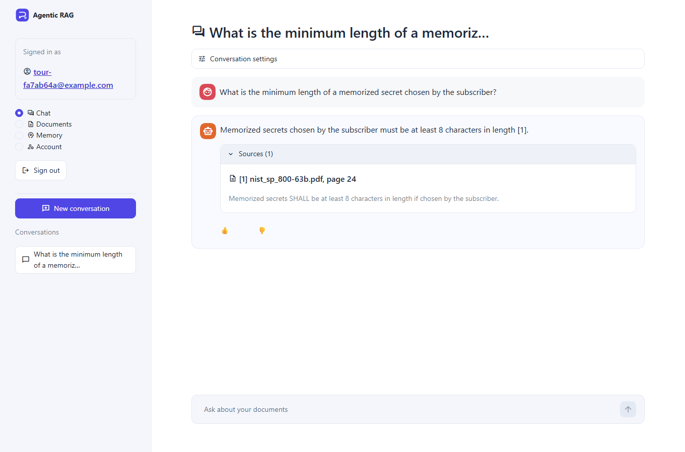
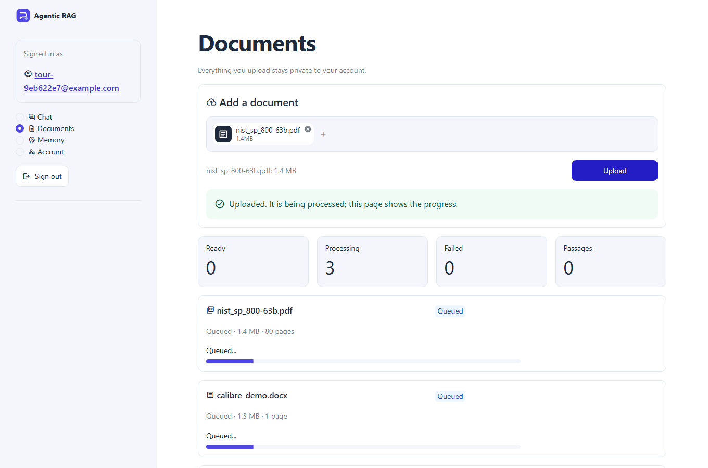
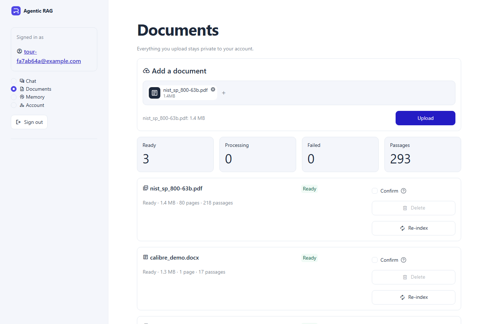
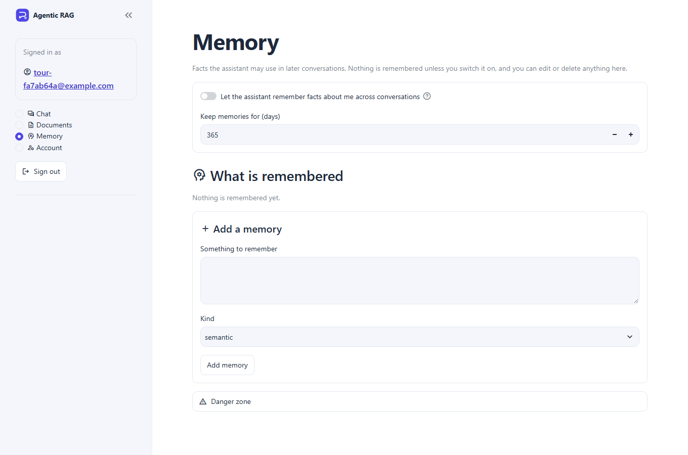
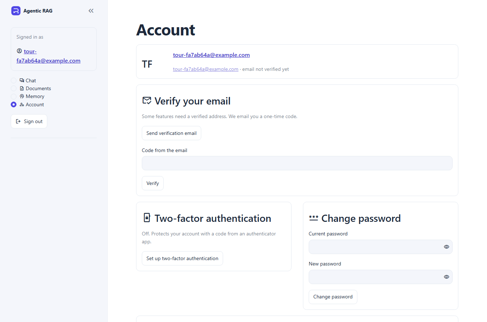
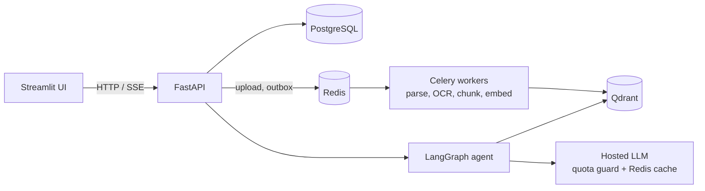

# Agentic RAG Platform

A multi-user platform that lets people **ask questions about their own documents and get answers they
can verify**. Every answer is built from the user's own uploads, every citation is checked by the
server against the passages that were actually retrieved, and one user can never see another user's
data.

Built with FastAPI, LangGraph, PostgreSQL, Qdrant, Redis/Celery and Streamlit. It runs on a laptop
against a **free hosted language model**: no GPU, no paid service and no local model download is needed
for the language model.

> Status: feature complete for the core product and thoroughly tested (1,202 automated tests passed; 93%
> line coverage, strict type checking, security and failure-recovery suites, plus a real-browser
> walk-through). Docker and cloud deployment verification remain open; load testing is skipped
> at the owner's request. See [Status and limitations](#status-and-limitations).

---

## Screenshots

From the running application in a real (headless) browser, with real public documents: NIST SP
800-63B (80 pages), the "Attention Is All You Need" paper and a Word demo file
([how they were produced](evaluation/reports/browser_tour_real_docs.md)).

| | |
|---|---|
|  |  |
| *Sign in (with opt-in "keep me signed in")* | *A cited answer: the excerpt behind [1] was verified against page 24* |
|  |  |
| *Live progress while documents are processed* | *Three real documents, 293 passages, ready to search* |
|  |  |
| *Opt-in long-term memory* | *Two-factor authentication, password, devices, account deletion* |

---

## A realistic use case

**Internal policy and contract assistant for a 200-person company.** The legal, HR and compliance
teams upload employee handbooks, supplier contracts, security policies and regulatory guidance
(PDF, Word, Markdown, CSV, text). Employees then ask things like *"How many days of parental leave do
contractors get?"* or *"Which of our supplier contracts allow termination for convenience?"*.

What the platform provides for that scenario:

- **Answers with proof.** Each answer carries citations (document, page, exact excerpt) that were
  verified server-side; if the documents do not contain the answer the assistant says so instead of
  guessing. An answer that cannot be verified is never shown.
- **Privacy by construction.** Every search is filtered by owner at the vector-store level, every API
  route checks ownership, and cross-user access returns the same `404` as a missing item. The language
  model never receives document ids, user ids or tools.
- **Operations you can reason about.** Uploads are processed in the background with retries and a
  state machine you can watch; the API stays responsive while documents are being parsed; every
  request has a trace id that follows it from the browser through the API into the background worker.
- **Cost control on free or metered models.** A built-in quota guard counts model requests per day,
  per minute and per user, refuses locally before the provider does, falls back to another model, and
  caches repeated questions in Redis.
- **Swap the model without touching code.** Any OpenAI-compatible endpoint works (Gemini, OpenRouter,
  Groq, or a self-hosted vLLM/Ollama server when documents must not leave the company).

---

## Features

**Documents and ingestion**
- Upload PDF, DOCX, TXT, Markdown and CSV. The file type is verified from the *content* (magic bytes,
  then a parser), never from the extension or the declared MIME type.
- Parsing runs in sandboxed child processes with time and memory limits (decompression bombs, XXE,
  entity bombs and malformed files are rejected safely).
- PDFs go through Docling (layout and tables); OCR (RapidOCR, open source) runs only for pages without
  a text layer; heading-aware chunking.
- Background processing with a transactional outbox, idempotent Celery tasks, a persisted document
  state machine, retries with backoff, a reconciler for stuck jobs, duplicate detection per owner, and
  clean deletion (hidden immediately, purged asynchronously).

**Retrieval and answers**
- Hybrid search in Qdrant (dense `bge-small` + BM25 sparse), Reciprocal Rank Fusion and a cross-encoder
  re-ranker; the owner filter is applied to every query.
- A **single-agent LangGraph** with a bounded repair loop: classify -> (small talk | clarify | retrieve
  -> generate -> verify -> repair or safe fallback) -> finalize -> persist
  (see [docs/ARCHITECTURE.md](docs/ARCHITECTURE.md#2-how-a-question-is-answered-the-langgraph-loop)).
- Versioned structured output (`RAGResponse`), server-side citation verification, prompt-injection-safe
  context construction, follow-up question rewriting, optional long-term memory with explicit consent.
- Streaming (Server-Sent Events) of answers that were already validated and saved; idempotency keys
  make retries safe; one running answer per conversation with explicit conflict handling.
- Persistent LangGraph checkpoints in PostgreSQL.

**Accounts and security**
- Argon2id passwords, JWT access tokens with rotating refresh tokens (reuse detection revokes the
  family), TOTP multi-factor authentication with recovery codes, email verification, password reset,
  account deletion, breached-password check, per-account and per-IP rate limiting (fail closed).
- Security response headers, CORS off by default, stable error codes with request ids and no stack traces,
  secrets only in `.env`.

**Interface**
- Streamlit app (custom theme): sign in/register (MFA step, opt-in "keep me signed in"), chat with
  streaming, source cards and suggested questions, feedback
  (thumbs and comment), conversation management, document upload with live progress bars and retry,
  memory management, account and device management.
- REST API under `/api/v1` with interactive docs at `/docs` (development).

**Observability and evaluation**
- OpenTelemetry traces and metrics (OTLP or a local JSONL file), trace context carried across the
  upload -> outbox -> worker boundary, request/trace ids in every response and log line, spans that
  never contain user content. See [docs/OBSERVABILITY.md](docs/OBSERVABILITY.md).
- Reproducible evaluation of chunking, retrieval, routing, agent failure handling and generation with
  committed reports ([docs/EVALUATION.md](docs/EVALUATION.md)).

---

## How it works



Full explanation, including the agent loop and a turn-by-turn sequence:
[docs/ARCHITECTURE.md](docs/ARCHITECTURE.md).

## Tech stack

| Layer | Technology |
|---|---|
| API | FastAPI (async), Pydantic v2, SQLAlchemy 2 (async) + Alembic |
| Agent | LangGraph (PostgreSQL checkpointer), OpenAI-compatible LLM client |
| Retrieval | Qdrant (dense + sparse), FastEmbed (`bge-small-en-v1.5`, BM25), cross-encoder re-ranker |
| Ingestion | Docling, RapidOCR, Celery + Redis, sandboxed parsers |
| Storage | PostgreSQL (source of truth), Redis (broker, cache, limits), local volume or S3-compatible objects |
| UI | Streamlit |
| Quality | pytest (unit, integration, end-to-end), Ruff, Pyright (strict), Locust (load tests) |
| Observability | OpenTelemetry (OTLP; works with Phoenix, Langfuse, Grafana Tempo, any collector) |

---

## Run it on your laptop

For hosted setup, see **[hosting preparation](docs/HOSTING.md)**: Streamlit is retained, with
Community Cloud as the free frontend alternative; Supabase PostgreSQL/Storage and a paid Render
backend reference are prepared. Vercel Functions do not provide the persistent Streamlit server,
and Render has no free Celery workers. No cloud deployment has been verified. Phase 11 load testing
is skipped at the owner's request.

You need: **Python 3.13** (via [uv](https://docs.astral.sh/uv/)), about **6 GB of free disk** (search
models and Docling download on first use) and **PostgreSQL, Redis and Qdrant** reachable on localhost
(Docker is the easiest way). A free language-model API key is optional: without it uploads, search and
everything except *answering* still work.

The complete, step-by-step guide with troubleshooting is **[docs/LOCAL_SETUP.md](docs/LOCAL_SETUP.md)**.
The short version:

```bash
# 1. get the code and the dependencies (creates a virtual environment, pinned by uv.lock)
git clone <this repository> && cd <repository>
uv sync --extra frontend

# 2. start PostgreSQL, Redis and Qdrant (Docker)
python scripts/init_env.py                     # writes .env with fresh random secrets
docker compose -f docker-compose.yml -f docker-compose.dev.yml up -d postgres redis qdrant

# 3. (optional) add a free model key to .env  ->  LLM_API_KEY=...   (see "Language model" below)

# 4. migrate the database and start API + worker + scheduler + UI
uv run --no-sync python scripts/stack.py start
```

Open **http://127.0.0.1:8501**, create an account, upload a document and ask a question. Stop
everything with `uv run --no-sync python scripts/stack.py stop`.

On Windows without Docker, native services can be installed once and started with
`scripts/dev_services.ps1`; see [docs/LOCAL_SETUP.md](docs/LOCAL_SETUP.md#windows-without-docker).

### Using the app

1. **Create an account** (the *Create account* tab). Passwords must be strong and not in the
   breached-password list.
2. **Documents** -> upload a file. Watch it move through *Queued -> Reading the text -> Splitting ->
   Computing embeddings -> Indexing -> Ready*. A failed document shows a plain-language reason and a
   *Retry* button when retrying can help.
3. **Chat** -> ask a question. The answer streams in; open **Sources** to see the document, page and
   exact excerpt behind each citation. Use 👍/👎 to rate it. Follow-up questions ("and for 2023?") are
   understood in context.
4. **Memory** (optional) -> switch it on to let the assistant remember stable facts about you
   (for example your preferred language) across conversations; you can view, edit and delete them.
5. **Account** -> see where you are signed in, sign out other devices, change your password.

### Using the API directly

```bash
API=http://127.0.0.1:8000/api/v1
curl -s $API/auth/register -H 'content-type: application/json' \
     -d '{"email":"me@example.com","password":"a-long-Unusual-passphrase-42"}'
TOKEN=$(curl -s $API/auth/login -H 'content-type: application/json' \
     -d '{"email":"me@example.com","password":"a-long-Unusual-passphrase-42"}' | python -c "import sys,json;print(json.load(sys.stdin)['access_token'])")
curl -s $API/documents/upload -H "Authorization: Bearer $TOKEN" -F file=@handbook.pdf
SESSION=$(curl -s $API/sessions -H "Authorization: Bearer $TOKEN" -H 'content-type: application/json' -d '{}' \
     | python -c "import sys,json;print(json.load(sys.stdin)['id'])")
curl -N $API/chat/stream -H "Authorization: Bearer $TOKEN" -H 'content-type: application/json' \
     -H "Idempotency-Key: $(python -c 'import uuid;print(uuid.uuid4())')" \
     -d "{\"session_id\":\"$SESSION\",\"message\":\"What is the notice period?\"}"
```

The full endpoint list is in [docs/API_SPECIFICATION.md](docs/API_SPECIFICATION.md); interactive docs
are served at `/docs` while `APP_ENV=dev`.

### Language model (free hosted API)

Set three values in `.env` (or run `python scripts/init_env.py --llm openrouter|groq|gemini`):

```
LLM_BASE_URL=https://generativelanguage.googleapis.com/v1beta/openai   # any OpenAI-compatible URL
LLM_API_KEY=...                                                        # from the provider's console
LLM_MODEL=gemini-3.5-flash-lite
```

Free tiers have small daily quotas that providers change without notice; the application counts its
own requests (`LLM_DAILY_REQUEST_BUDGET`, `LLM_REQUESTS_PER_MINUTE`, `RL_CHAT_DAILY_LIMIT`) so it
degrades gracefully instead of failing mid-conversation. Details and calibration:
[docs/DEPLOYMENT.md](docs/DEPLOYMENT.md#language-model-free-hosted-api-no-local-model). **Documents
and questions are sent to the model provider**: choose one whose terms fit your data, or self-host an
OpenAI-compatible server and point `LLM_BASE_URL` at it ([docs/SECURITY.md](docs/SECURITY.md)).

---

## Quality, tests and measured results

```bash
uv run --no-sync pytest backend/tests/unit              # 594 tests, no services needed
uv run --no-sync pytest                                 # 1,203 collected; 1 optional live-model skip
uv run --no-sync ruff check . && uv run --no-sync ruff format --check . && uv run --no-sync pyright
```

PowerShell users can run one category at a time: `scripts/test.ps1 -Category unit|integration|e2e|security|concurrency|failure|frontend|quality`
(see [docs/TESTING_STRATEGY.md](docs/TESTING_STRATEGY.md) for what each category covers). Tests use
real PostgreSQL, Redis, Qdrant and Celery, never call a paid or hosted model, and the security and
failure-recovery suites cover injection, token misuse, cross-user access, dependency outages, worker
crashes and client disconnects.

Measured on a laptop CPU with a small **synthetic** corpus (6 documents, 36 questions; numbers rank
configurations, they do not promise quality on your data; full tables and caveats in
[docs/EVALUATION.md](docs/EVALUATION.md) and `evaluation/reports/`):

| Retrieval configuration (natural questions) | hit@1 | hit@3 | MRR | median latency |
|---|---|---|---|---|
| dense only | 0.58 | 0.72 | 0.69 | 9 ms |
| BM25 only | 0.53 | 0.81 | 0.66 | 3 ms |
| hybrid (RRF) | 0.72 | 0.92 | 0.82 | 10 ms |
| hybrid + cross-encoder re-rank (default) | 0.94 | 0.94 | 0.94 | 2.2 s |

The same four configurations on **real public documents** (NIST SP 800-63B, 80 pages, and "Attention
Is All You Need", 15 pages; 28 hand-written questions; the files are downloaded and hash-checked, never
committed; [report](evaluation/reports/retrieval_real_docs.md)) look quite different, which is why the
synthetic numbers above must not be read as a promise:

| Retrieval configuration (real documents) | hit@1 | hit@3 | MRR |
|---|---|---|---|
| dense only | 0.61 | 0.71 | 0.68 |
| BM25 only | 0.39 | 0.54 | 0.51 |
| hybrid (RRF) | 0.46 | 0.68 | 0.61 |
| hybrid + cross-encoder re-rank (default) | 0.64 | 0.75 | 0.72 |

(On these documents plain hybrid is *worse* than dense alone and the re-ranker recovers it; the ground
truth is strict, one sentence = one chunk, so absolute values are pessimistic.)

With real, larger public documents in a real browser
([report](evaluation/reports/browser_tour_real_docs.md)): an 80-page NIST standard, a 15-page research
paper and a Word file were processed in 244 s, 83 s and 84 s on a laptop CPU, and six questions about
them were answered correctly with verified page citations in 2.9-6.5 s each.

With a real free model (`gemini-3.5-flash-lite`, 46 questions): valid structured output on the first
try for 94% of answerable questions, the correct source cited for 94%, 100% correct refusals on the
unanswerable ones, median answer latency 3.5 s.

---

## Project layout

```
backend/        FastAPI app (api, services, repositories, models, agents, retrieval, ingestion,
                memory, llm, infra, tasks), Alembic migrations, tests
frontend/       Streamlit app (API client, views)
evaluation/     datasets, evaluation scripts and committed reports
load_testing/   concurrency benchmark (Locust scenarios in progress)
scripts/        init_env.py, stack.py (run everything), dev_services.ps1, test.ps1
docs/           architecture, API, security, testing, evaluation, observability, deployment, decisions
```

## Status and limitations

Honest summary of what is verified and what is not (details in [docs/KNOWN_ISSUES.md](docs/KNOWN_ISSUES.md)):

- **Verified here:** the whole backend and UI against real PostgreSQL, Redis, Qdrant and Celery on
  Windows; the real hosted-model path with Gemini's free tier.
- **Not yet verified:** Docker images and the full Compose stack, a live hosted S3-compatible
  object store (only an emulator was tested), cloud deployment and behaviour under load
  (Phase 11 is skipped at the owner's request). The UI and the whole workflow were verified
  in a real headless browser with real documents.
- **By design:** answers stream only after they are validated and saved, so the first token arrives
  with the full answer (status events cover the wait); access tokens never reach the browser ("keep me
  signed in" stores only a revocable handle); the re-ranker costs about 2 s per question on a CPU.
- Free-tier model quotas and model names change without notice.

## Documentation

| Topic | Document |
|---|---|
| Set up and use it locally | [docs/LOCAL_SETUP.md](docs/LOCAL_SETUP.md) |
| Architecture and the agent loop | [docs/ARCHITECTURE.md](docs/ARCHITECTURE.md) |
| Decisions and their reasons | [docs/ARCHITECTURE_DECISIONS.md](docs/ARCHITECTURE_DECISIONS.md) |
| API reference | [docs/API_SPECIFICATION.md](docs/API_SPECIFICATION.md) |
| Security model | [docs/SECURITY.md](docs/SECURITY.md) |
| Observability and traces | [docs/OBSERVABILITY.md](docs/OBSERVABILITY.md) |
| Evaluation | [docs/EVALUATION.md](docs/EVALUATION.md) |
| Testing strategy | [docs/TESTING_STRATEGY.md](docs/TESTING_STRATEGY.md) |
| Frontend | [docs/FRONTEND.md](docs/FRONTEND.md) |
| Deployment and model setup | [docs/DEPLOYMENT.md](docs/DEPLOYMENT.md) |
| Known issues | [docs/KNOWN_ISSUES.md](docs/KNOWN_ISSUES.md) |
| Third-party licences | [docs/LICENSES.md](docs/LICENSES.md) |

## License

Licence to be added by the repository owner (see docs/KNOWN_ISSUES.md). Third-party components are
open source; see [docs/LICENSES.md](docs/LICENSES.md).
