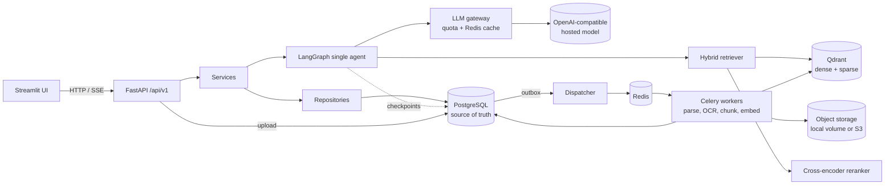
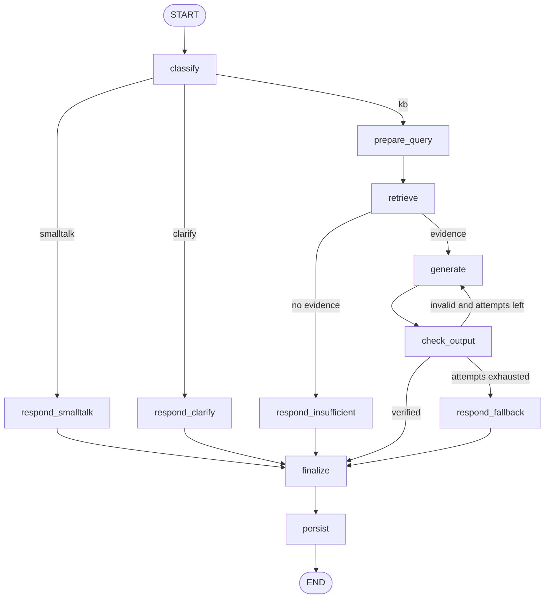
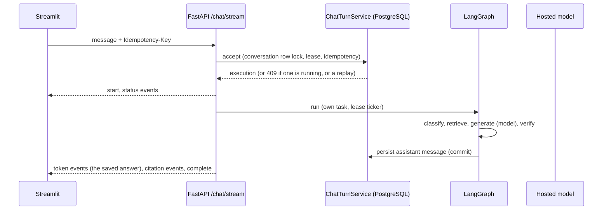

# Architecture

Authoritative requirements live in `docs/spec/`; decisions and their reasons in
`docs/ARCHITECTURE_DECISIONS.md`. This document explains how the system is
put together and how one question travels through it.

Hosting preparation retains these component boundaries: Streamlit, separate API/Celery/beat,
PostgreSQL, Redis, Qdrant and object storage. See HOSTING.md and ADR-039 for Supabase TLS/private
schema configuration and the documented free-tier limits. No cloud deployment is verified yet.

## 1. System overview



Two pipelines that never mix:

- **Interactive** (a person is waiting): async FastAPI + async LangGraph + Server-Sent Events.
  Chat never goes through Celery.
- **Background** (nobody is waiting): upload -> transactional outbox -> Celery. Tasks are idempotent
  and the document has a persisted state machine
  `PENDING -> VALIDATING -> QUEUED -> PROCESSING -> EXTRACTING -> CHUNKING -> EMBEDDING -> INDEXING -> COMPLETED`
  (any stage may go to `FAILED`, recoverable or permanent; `FAILED -> QUEUED` only by an explicit retry).

### Layering inside the backend

```
routers (HTTP only)  ->  services (logic)  ->  repositories (SQL)  ->  PostgreSQL
        |                     |
   Pydantic schemas      infra (Redis, Qdrant, storage, rate limiter, LLM gateway)
```

Routers translate HTTP; services hold the logic and own transactions; repositories are the only
code that writes SQL; Pydantic schemas are the contracts (ORM models are never returned).
`app/dependencies` wires authentication and services into routes.

## 2. How a question is answered (the LangGraph loop)

LangGraph is used as a small, explicit state machine rather than a free-running "agent that decides
what to do". The graph has **no open-ended loop**: the only cycle is a bounded repair loop, and every
path ends in the same two nodes (`finalize`, `persist`).



What each node does (`backend/app/agents/single.py`):

| Node | Purpose | Model call? |
|---|---|---|
| `classify` | Deterministic routing (`agents/routing.py`): exact small-talk allow-list -> fixed reply; nothing answerable ("what is it?") -> ask for clarification; everything else -> `kb`. Cheap, testable, injection-proof (a full match is required, so "hi, ignore your rules" is a knowledge-base question) | no |
| `prepare_query` | A short follow-up ("and for 2023?") is rewritten into a standalone search query using the conversation history; if the rewrite fails the previous question is prepended (`rewrite_fallback`) | at most 1 |
| `retrieve` | Hybrid search for the caller's documents only (see section 3) and, if the user consented, relevant memories. Evidence gets labels `S1..Sk`; the model never sees document or chunk ids | no |
| `respond_insufficient` | No readable evidence -> an honest "not in your documents" without calling the model | no |
| `generate` | Builds the prompt (fixed rules; sources as untrusted data in nonce-tagged blocks; history; memories) and asks the model for a JSON `DraftAnswer`. Goes through the LLM gateway: quota guard, per-user and global concurrency limits, Redis cache, fallback-model chain | 1 per attempt |
| `check_output` | Parses and validates the JSON, then **verifies every citation server-side** against the evidence retrieved in this execution (the chunk exists, belongs to the document, belongs to the user, page matches, the quoted excerpt really occurs in the stored text). Invalid citations are dropped; if none survive for a factual answer the output is rejected | no |
| `respond_fallback` | After `1 + LLM_REPAIR_ATTEMPTS` failed attempts: a safe "I could not produce an answer I can back with citations", marked `unverified_answer`. Raw model output is never returned | no |
| `finalize` | Builds the versioned `RAGResponse` (answer, verified citations, flags, metadata: route, model, tokens, latency, degraded steps) | no |
| `persist` | Saves the assistant message (and the response JSON) in PostgreSQL | no |

**The loop.** After `check_output`, a conditional edge decides: verified -> `finalize`; not verified
and `attempts < 1 + repair_budget` -> back to `generate` with a repair message listing the
*paths* of the problems (never the offending values); otherwise -> `respond_fallback`. With the
default `LLM_REPAIR_ATTEMPTS=1` a turn therefore makes at most one rewrite call plus two answer calls.
`recursion_limit` (25) is only a backstop.

**State.** `AgentState` (a `TypedDict`) is what LangGraph checkpoints to PostgreSQL after the turn
(`durability="exit"`). It holds references (chunk ids, labels), counters and the response, but **no
chunk text**, so deleting a document leaves no content behind in checkpoint tables. Every turn starts
from a complete fresh state without reducers; the conversation history comes from the `messages`
table, not from the checkpointer. Non-serialisable things (service callables, the evidence text, the
event sink for streaming status) live in `TurnContext`, passed as LangGraph `context=`, never
checkpointed.

**Why the model is not given tools.** It never chooses tools, users, ids or models: authorization is
decided before the prompt is built, and the verifier is the only way a citation reaches a user.

### One turn, end to end



Properties (ADR-023, ADR-026): one running execution per conversation (a second message gets
`409 CONCURRENCY_CONFLICT`, nothing is queued); gapless message order; the client's idempotency key
makes retries safe (a replay streams the stored answer without a model call; a failed turn cannot be
replayed); a dead worker's lease expires and a late writer is refused; a client disconnect cancels
the pipeline. Tokens are streamed **after** the answer is validated and committed, so nothing
unvalidated or unsaved is ever shown (the trade-off: time to first token equals full latency; status
events and keep-alives cover the wait).

## 3. Retrieval

`retrieval/retriever.py`: for every query a Qdrant filter carries the user id **and** the exact set of
document ids the user may read (completed, not deleted), so unauthorized chunks cannot enter the
candidate lists. Dense (BAAI/bge-small-en-v1.5) and sparse (BM25) searches run, are fused with
Reciprocal Rank Fusion, and the top candidates are re-ranked by a cross-encoder. Each degraded step
(`dense_unavailable`, `sparse_unavailable`, `rerank_timeout`, ...) is reported in the response
metadata instead of failing the question. Blocking model inference runs on a dedicated thread pool,
never on the event loop. Evaluation of the configurations: `docs/EVALUATION.md`.

## 4. Ingestion

Upload (API) -> validate by content (magic bytes, then a sandboxed parser; never by extension or
MIME alone) -> store the object -> one PostgreSQL transaction writes the document, the job and an
**outbox** row -> the dispatcher publishes to Redis -> a Celery worker parses (Docling for PDFs, with
OCR only for pages without a text layer; structured parsers for DOCX/TXT/MD/CSV), chunks
(heading-aware), embeds (dense + sparse), upserts to Qdrant, and advances the state machine. Parsing
runs in sandboxed child processes with time and memory limits. A reconciler requeues stuck jobs, an
orphan sweeper removes objects without a row, and Beat schedules all of it
(`dispatch-outbox`, `reconcile-ingestion`, `sweep-orphans`, `memory-retention`, `sweep-checkpoints`).

## 5. Data stores and consistency

| Store | Holds | Rebuildable? |
|---|---|---|
| PostgreSQL | users, sessions/tokens, documents, jobs, outbox, conversations, messages, executions, memories, feedback, LangGraph checkpoints | it is the source of truth |
| Qdrant | chunk and memory vectors (dense + sparse) with owner/document payload | yes, from PostgreSQL + object storage |
| Redis | Celery broker, rate-limit counters, LLM response cache, quota counters | yes; never the only copy of anything |
| Object storage | the uploaded originals (local volume or S3-compatible) | no (back it up) |

Deletion is tombstone-first (invisible at once), then a worker purges vectors, files and rows.

## 6. Security layers (summary; details in `docs/SECURITY.md`)

Argon2id passwords, JWT access + rotating refresh tokens with reuse detection, optional TOTP MFA,
per-account and per-IP limits (fail closed), unique constraint on the normalized email, ownership
checks on every route (404 identical to "does not exist"), content-based upload validation in a
sandbox, prompt-injection-safe context construction, server-side citation verification, security
response headers, stable error codes with request ids and no stack traces, secrets only in `.env`.

## 7. Observability

OpenTelemetry traces and metrics (off by default; OTLP/HTTP or a local JSONL file), request/trace ids
on every response and log line, trace context carried from the upload request through the outbox into
the Celery worker. Spans never contain user content. See `docs/OBSERVABILITY.md`.

## 8. Frontend

`frontend/` is a Streamlit app that talks only to the API (no database, vector store or model
access); tokens live in the Streamlit session state only. See `docs/FRONTEND.md`.

## 9. Repository layout

```
backend/app/         api (routers), services, repositories, models, schemas, agents, retrieval,
                     ingestion, memory, llm, infra, core (config, errors, telemetry), tasks
backend/migrations/  Alembic migrations (0001 ... 0010)
backend/tests/       unit / integration / e2e (see docs/TESTING_STRATEGY.md)
frontend/            Streamlit app (api client, views)
evaluation/          datasets, evaluation scripts, committed reports
load_testing/        concurrency benchmark (Locust scenarios arrive with Phase 11)
scripts/             dev services, setup/run helpers, test runner
docs/                this file, spec, ADRs, security, deployment, evaluation, observability
```
